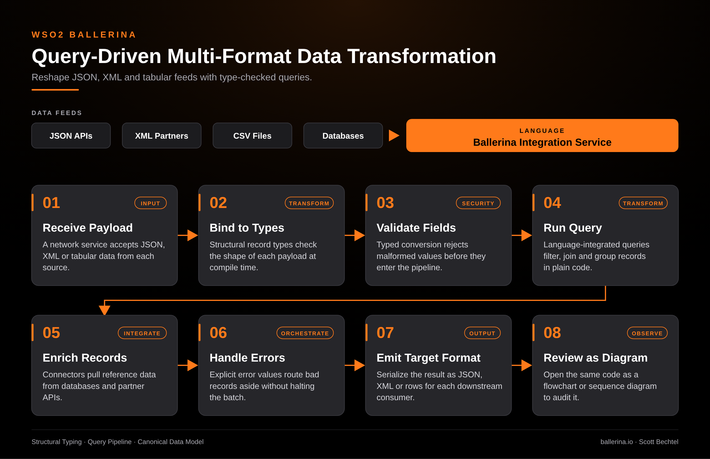

# Ballerina: Query-Driven Multi-Format Data Transformation

**Date:** 2026-10-11  **Product:** [Ballerina](https://ballerina.io/)

## Business Problem

Every integration team ends up with the same mess: one partner sends XML, another sends CSV, the core API speaks JSON, and the glue is a pile of mapping scripts nobody wants to touch. A field gets renamed upstream and you find out in production, usually from a bad record that slipped three steps downstream before anything noticed.

## How WSO2 Solves This

Ballerina treats data shape as part of the language. You bind each payload to a structural type, and the compiler checks it before anything runs. Language-integrated queries then filter, join, and group JSON, XML, and tabular data in ordinary code, with no second mapping tool in the loop. Errors are explicit values, so a bad record goes aside without killing the batch, and the same code can be opened as a flowchart or sequence diagram when someone else needs to review it.

## Patterns Used

- Structural Typing
- Query Pipeline
- Canonical Data Model

## Architecture

WSO2 Ballerina · ballerina.io ·  by, Scott Bechtel
