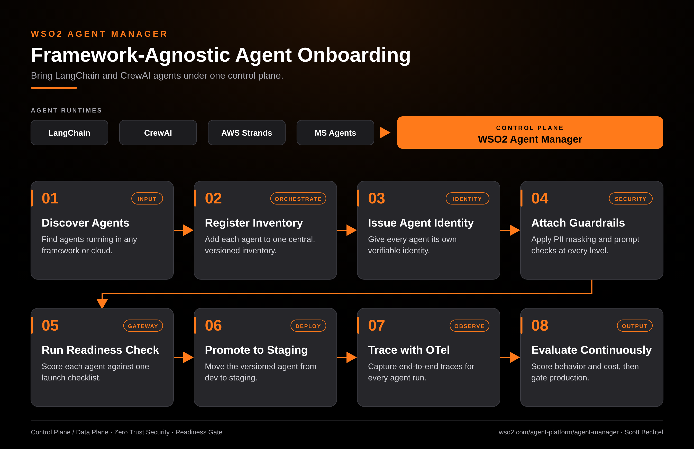

# Agent Manager: Framework-Agnostic Agent Onboarding

**Date:** 2026-10-12  **Product:** [Agent Manager](https://wso2.com/agent-platform/agent-manager/)

## Business Problem

Every team picked its own agent framework. One group ships on LangChain, another on CrewAI, a third on AWS Strands. Each agent carries its own credentials, its own logging and its own idea of "ready for production". Nobody can say how many agents are running, and the ones nobody registered are the ones that cause the incident.

## How WSO2 Solves This

Agent Manager gives all of those agents one place to land, no matter which framework built them. Each agent goes into a central inventory, gets its own verifiable identity, and picks up guardrails like PII masking and prompt checks. Then it runs through the same readiness checklist before it moves from dev to staging to production. OpenTelemetry traces and continuous evaluations show what each agent actually does after launch, so adding a new framework later doesn't mean rebuilding governance.

## Patterns Used

- Control Plane / Data Plane
- Zero Trust Security
- Readiness Gate

## Architecture

WSO2 Agent Manager · wso2.com/agent-platform/agent-manager ·  by, Scott Bechtel
