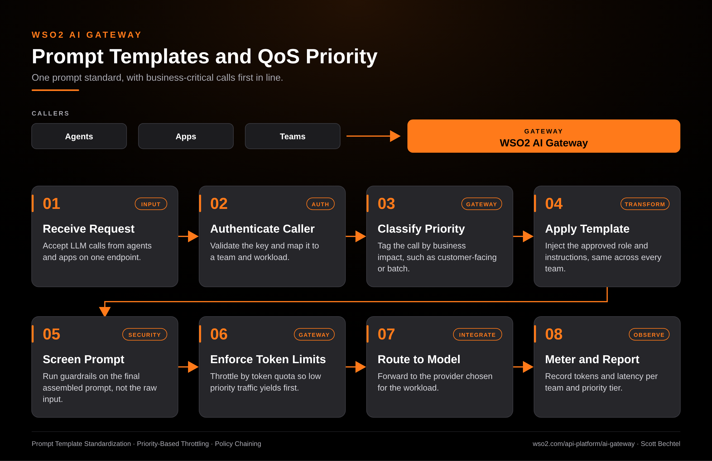

# AI Gateway: Prompt Templates and QoS Priority Flow

**Date:** 2026-10-13  **Product:** [AI Gateway](https://wso2.com/api-platform/ai-gateway/)

## Business Problem
Every team writes its own system prompt, so the same model behaves differently from one app to the next, and nobody can say which version is live. Meanwhile a nightly batch job and a customer-facing agent share the same provider quota, and when the limit hits, the customer feels it first.

## How WSO2 Solves This
The WSO2 AI Gateway applies approved prompt templates centrally, so roles and instructions are set once instead of copied into every app. Token-level and subscription-level limits then decide who gets throttled, and outbound traffic is prioritized by business impact, so batch work yields before the calls customers are waiting on. Guardrails run on the final assembled prompt, and every call is metered per team and tier under the same governance model you use for APIs and MCP.

## Patterns Used
- Prompt Template Standardization
- Priority-Based Throttling
- Policy Chaining

## Architecture

WSO2 AI Gateway · wso2.com/api-platform/ai-gateway ·  by, Scott Bechtel
