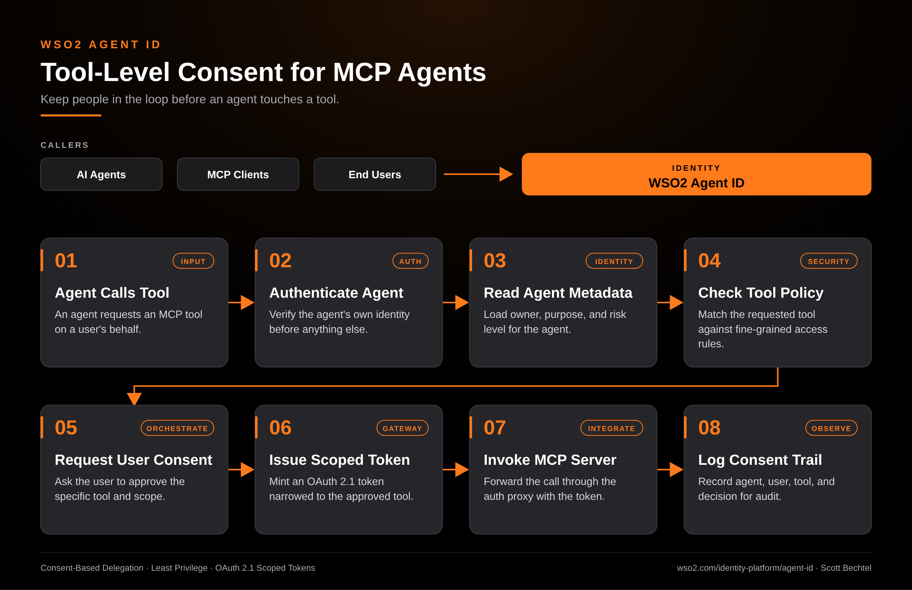

# Agent ID: Tool-Level Consent for MCP Agents

**Date:** 2026-10-14  **Product:** [Agent ID](https://wso2.com/identity-platform/agent-id/)

## Business Problem

An agent connected to an MCP server can reach every tool that server exposes. Once someone approves the agent, nobody asks again when it calls the payments tool or the delete-records tool. Security teams end up with broad grants they can't explain and no record of who agreed to what.

## How WSO2 Solves This

WSO2 Agent ID treats the agent as its own identity, with an owner, a purpose, and a risk level stored alongside it. When an agent requests an MCP tool, the platform checks who the agent is, applies tool-level access rules, and asks the user to approve that specific tool and scope when the policy calls for it. It then issues an OAuth 2.1 token narrowed to what the user approved. The open-source MCP Auth Proxy lets you put this in front of existing MCP servers without changing their code. Every decision lands in an audit trail kept apart from human activity.

## Patterns Used

- Consent-Based Delegation
- Least Privilege
- OAuth 2.1 Scoped Tokens

## Architecture

---
WSO2 Agent ID · wso2.com/identity-platform/agent-id ·  by, Scott Bechtel
