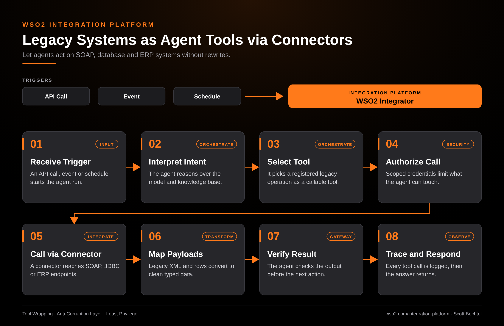

# WSO2 Integration Platform: Legacy Systems as Agent Tools via Connectors

**Date:** 2026-10-15  **Product:** [WSO2 Integration Platform](https://wso2.com/integration-platform/)

## Business Problem

Most enterprises run their critical logic in SOAP services, relational databases, and ERP modules that nobody wants to rewrite. AI agents are only useful if they can act on those systems, yet pointing a model straight at a legacy endpoint is a security and reliability risk. Teams end up building one-off glue code for every agent.

## How WSO2 Solves This

WSO2 Integration Platform lets you register legacy operations as tools an agent can call. Its 600+ connectors reach SOAP, JDBC, and ERP endpoints, so nothing behind them has to change. A mapping step turns XML and rows into clean typed data, and scoped credentials limit what each agent can touch. Every tool call is traced from the same control plane, so you can see what the agent did and why.

## Patterns Used

- Tool Wrapping
- Anti-Corruption Layer
- Least Privilege

## Architecture

WSO2 Integration Platform · wso2.com/integration-platform ·  by, Scott Bechtel
