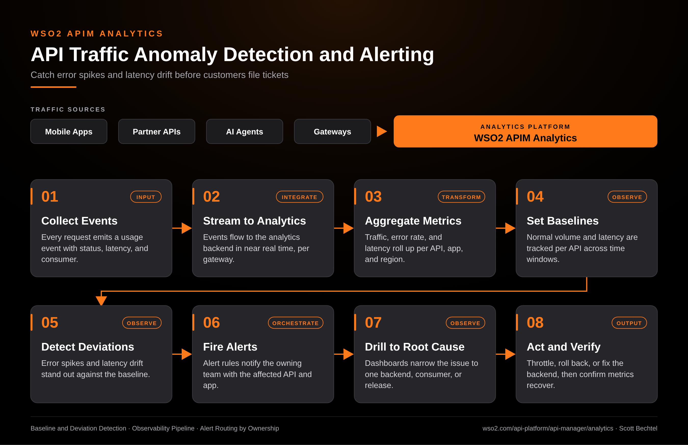

# APIM Analytics: API Traffic Anomaly Detection and Alerting

**Date:** 2026-10-16  **Product:** [APIM Analytics](https://wso2.com/api-platform/api-manager/analytics/)

## Business Problem

Most API teams find out about a bad release from a support ticket. Error rates creep up on one endpoint, latency doubles for one partner, and nobody sees it until a customer complains. Looking at raw gateway logs after the fact is slow, and a fixed threshold either fires all day or never.

## How WSO2 Solves This

WSO2 APIM Analytics takes the usage events your gateways already emit and rolls them up per API, application, and region. It tracks what normal looks like for each API, so a jump in errors or a slow drift in latency stands out. Alert rules send the owning team a message that names the API and the consuming app. From there you drill into the dashboard, find the backend or release behind it, and confirm the numbers recover after the fix.

## Patterns Used

- Baseline and Deviation Detection
- Observability Pipeline
- Alert Routing by Ownership

## Architecture

WSO2 APIM Analytics · wso2.com/api-platform/api-manager/analytics ·  by, Scott Bechtel
