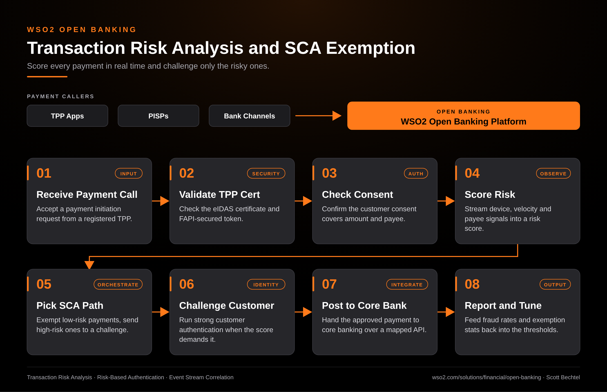

# Open Banking: Transaction Risk Analysis and SCA Exemption

**Date:** 2026-10-17  **Product:** [Open Banking](https://wso2.com/solutions/financial/open-banking/)

## Business Problem

Strong customer authentication on every payment frustrates customers and drives abandoned checkouts. Skipping it on risky payments invites fraud and regulator attention. Banks need a way to tell the two apart per transaction, in real time.

## How WSO2 Solves This

WSO2 Open Banking validates the TPP certificate, checks the customer's consent, and scores each payment against device, velocity and payee signals before anything moves. Low-risk payments qualify for an SCA exemption and go straight through. High-risk ones get routed to a challenge. Approved payments land in core banking through mapped APIs, and fraud and exemption numbers flow back so the thresholds get tuned from real data.

## Patterns Used

- Transaction Risk Analysis
- Risk-Based Authentication
- Event Stream Correlation

## Architecture

WSO2 Open Banking · wso2.com/solutions/financial/open-banking ·  by, Scott Bechtel
