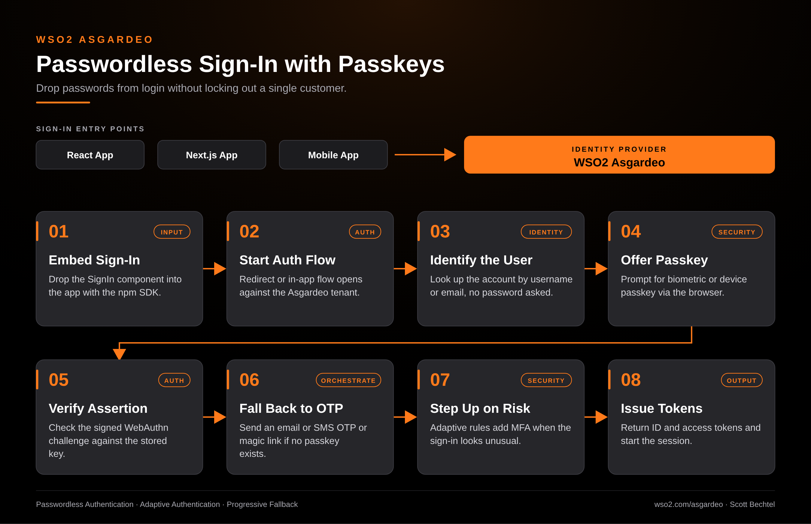

# Asgardeo: Passwordless Sign-In with Passkeys

**Date:** 2026-10-18  **Product:** [Asgardeo](https://wso2.com/asgardeo/)

## Business Problem

Passwords are still the weakest link in most customer-facing apps. They get reused, phished and reset constantly, and every reset ticket costs support time. Teams want passwordless login, but a hard cutover strands users who don't have a passkey yet.

## How WSO2 Solves This

Asgardeo gives you drop-in SignIn components for React, Next.js and Vue, so passwordless login ships in an afternoon instead of a quarter. Users sign in with a passkey or biometric where one exists. Where one doesn't, the flow falls back to an email or SMS OTP or a magic link, so nobody gets locked out. Adaptive authentication adds MFA only when a sign-in looks unusual, which keeps the common path fast.

## Patterns Used

- Passwordless Authentication
- Adaptive Authentication
- Progressive Fallback

## Architecture

WSO2 Asgardeo · wso2.com/asgardeo ·  by, Scott Bechtel
