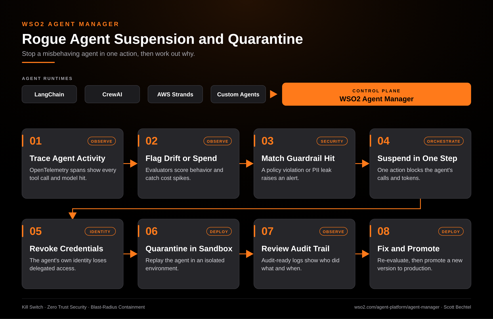

# Agent Manager: Rogue Agent Suspension and Quarantine

**Date:** 2026-10-19  **Product:** [Agent Manager](https://wso2.com/agent-platform/agent-manager/)

## Business Problem
An agent that loops on a tool, leaks PII, or burns through tokens at 2 a.m. does damage in minutes. Most teams can't tell which agent is responsible, and they have no single place to shut it off. They end up revoking a shared service account and taking healthy agents down with it.

## How WSO2 Solves This
Agent Manager is the control plane for agents running on LangChain, CrewAI, AWS Strands, or your own code. OpenTelemetry traces and continuous evaluations flag drift or a spending spike, and guardrails catch policy violations as they happen. One action suspends the agent and pulls its credentials, because each agent has its own identity instead of a borrowed one. You then replay it in a sandbox, read the audit trail, and promote a fixed version through the normal dev-to-production path.

## Patterns Used
- Kill Switch
- Zero Trust Security
- Blast-Radius Containment

## Architecture

WSO2 Agent Manager · wso2.com/agent-platform/agent-manager ·  by, Scott Bechtel
