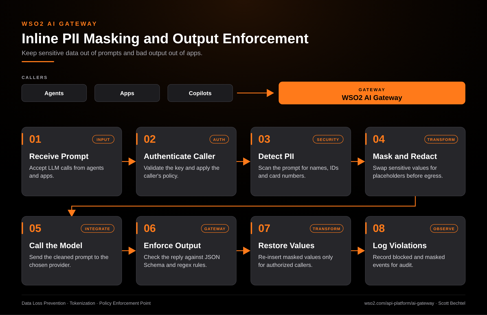

# AI Gateway: Inline PII Masking and Output Enforcement Flow

**Date:** 2026-10-20  **Product:** [AI Gateway](https://wso2.com/api-platform/ai-gateway/)

## Business Problem
Developers paste customer records into prompts all the time, and most of them don't realize the provider now has a copy. On the way back, a model that was asked for JSON can return prose, a made-up field, or a URL nobody approved. Once an agent is wired to that reply, one bad response can break a downstream system.

## How WSO2 Solves This
The WSO2 AI Gateway sits between your agents and every LLM provider, so the checks happen in one place instead of in each app. It scans prompts for PII and masks or redacts it before anything leaves your network. When the reply comes back, the gateway checks it against JSON Schema and regex rules and blocks anything that doesn't fit. Authorized callers can get masked values restored, and every blocked or masked event lands in the audit log.

## Patterns Used
- Data Loss Prevention
- Tokenization
- Policy Enforcement Point

## Architecture

WSO2 AI Gateway · wso2.com/api-platform/ai-gateway ·  by, Scott Bechtel
