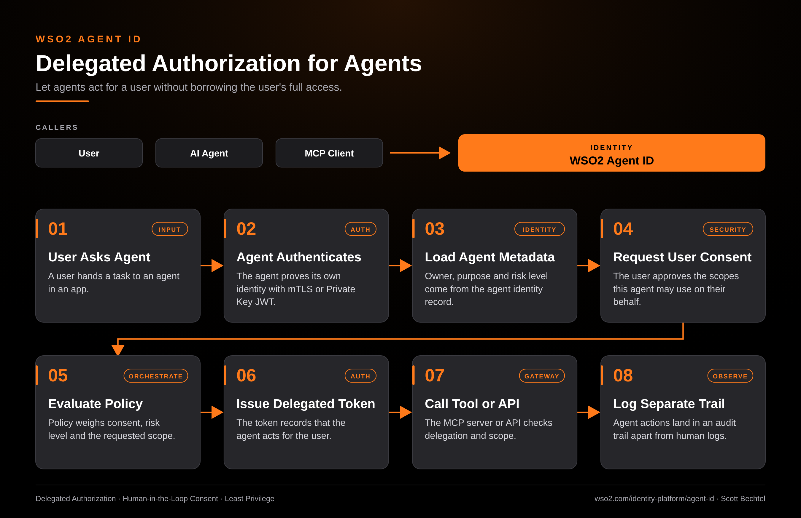

# Agent ID: Delegated Authorization for Agents

**Date:** 2026-10-21  **Product:** [Agent ID](https://wso2.com/identity-platform/agent-id/)

## Business Problem

A user asks an agent to book travel, pull records, or file a ticket, and the agent needs access to systems the user owns. Teams usually solve this by handing the agent the user's own credentials, which gives it everything the user can do and leaves no way to tell who acted. When something goes wrong, the audit log says the user did it.

## How WSO2 Solves This

WSO2 Agent ID gives the agent its own identity, separate from any human, and authenticates it with mTLS or Private Key JWT. When the agent needs to act for a user, Agent ID checks the agent's owner, purpose, and risk level, then asks the user to consent to specific scopes. Tokens carry delegation information that says the agent is acting on the user's behalf, so downstream MCP servers and APIs can enforce scope and see who is really calling. Agent actions land in an audit trail apart from human activity.

## Patterns Used

- Delegated Authorization
- Human-in-the-Loop Consent
- Least Privilege

## Architecture

WSO2 Agent ID · wso2.com/identity-platform/agent-id ·  by, Scott Bechtel
