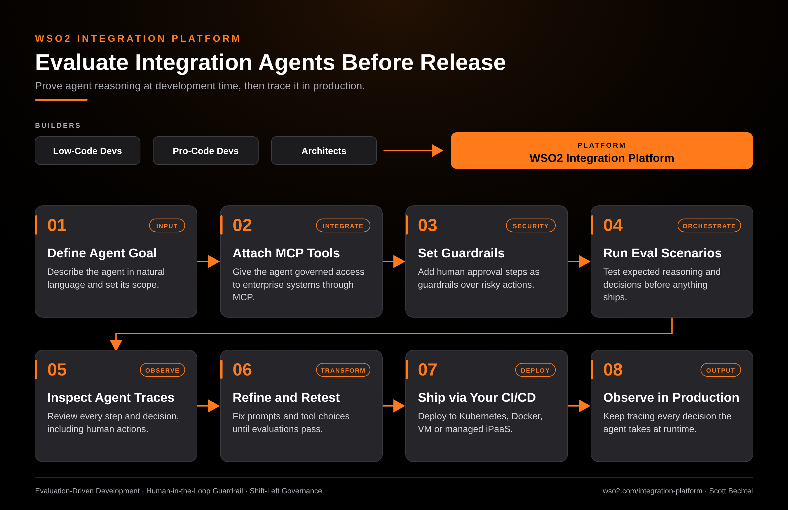

# WSO2 Integration Platform: Evaluate Integration Agents Before Release

**Date:** 2026-10-22  **Product:** [WSO2 Integration Platform](https://wso2.com/integration-platform/)

## Business Problem

An integration agent that picks the wrong tool or skips an approval step can touch real systems of record. Most teams only find that out after release, when the cost of a bad decision is already booked.

## How WSO2 Solves This

In WSO2 Integration Platform you describe the agent in natural language, attach enterprise systems as MCP tools, and put human approval steps in front of risky actions. Then you evaluate the agent's expected reasoning and decisions at development time, before anything ships. Traces show every step it took, including human actions, so you can fix a prompt or a tool choice and rerun. Once the evaluations pass, deploy through your own CI/CD to Kubernetes, Docker, a VM, or the managed iPaaS, and keep the same tracing on in production.

## Patterns Used

- Evaluation-Driven Development
- Human-in-the-Loop Guardrail
- Shift-Left Governance

## Architecture

WSO2 Integration Platform · wso2.com/integration-platform ·  by, Scott Bechtel
