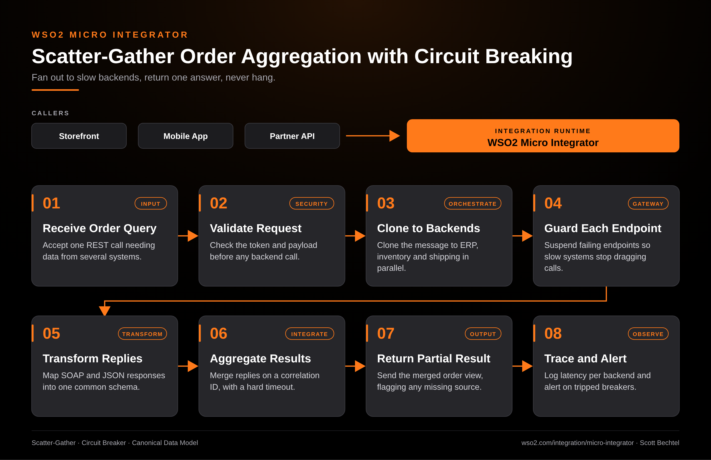

# Micro Integrator: Scatter-Gather Order Aggregation with Circuit Breaking

**Date:** 2026-10-23  **Product:** [Micro Integrator](https://wso2.com/integration/micro-integrator/)

## Business Problem

A single order-status screen needs data from the ERP, the inventory system, and a shipping carrier. Each one answers on its own schedule. Call them one after another and the slowest system sets your response time. Let one of them stall and the whole page hangs.

## How WSO2 Solves This

WSO2 Micro Integrator takes the one inbound REST call and clones it to all three backends at the same time. Each endpoint carries its own suspension rules, so a system that keeps failing gets taken out of rotation instead of piling up blocked threads. The replies come back in SOAP and JSON, get mapped to one canonical schema, and merge on a correlation ID under a hard timeout. If a source is late or down, the caller still gets the rest of the order view, with that source flagged as missing. Because the runtime is small and container-friendly, you can run it next to the services it fronts.

## Patterns Used

- Scatter-Gather
- Circuit Breaker
- Canonical Data Model

## Architecture

---
WSO2 Micro Integrator · wso2.com/integration/micro-integrator ·  by, Scott Bechtel
