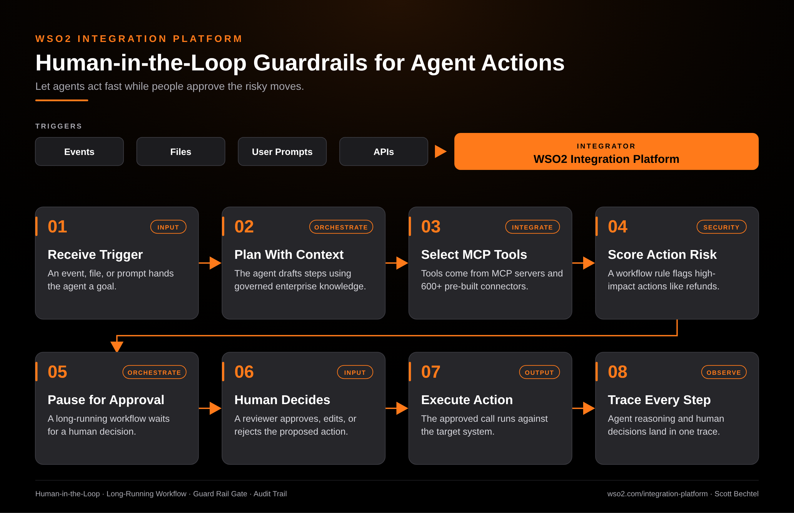

# WSO2 Integration Platform: Human-in-the-Loop Guardrails for Agent Actions

**Date:** 2026-10-29  **Product:** [WSO2 Integration Platform](https://wso2.com/integration-platform/)

## Business Problem

An agent that can refund an order, change a record, or message a customer is only useful if the business trusts it with those actions. Without a checkpoint, teams either lock the agent down to read-only or let it act with no review. Neither one ships.

## How WSO2 Solves This

WSO2 Integration Platform builds agents, integrations, and workflows in one place, so the approval step lives in the same flow as the agent. The agent plans with governed enterprise context and picks its tools through MCP servers and the 600+ connectors. A workflow rule flags the high-impact actions and pauses for a person to approve, edit, or reject. Every reasoning step and every human decision lands in the same trace, so you can see who approved what.

## Patterns Used

- Human-in-the-Loop
- Long-Running Workflow
- Guard Rail Gate
- Audit Trail

## Architecture

WSO2 Integration Platform · wso2.com/integration-platform ·  by, Scott Bechtel
