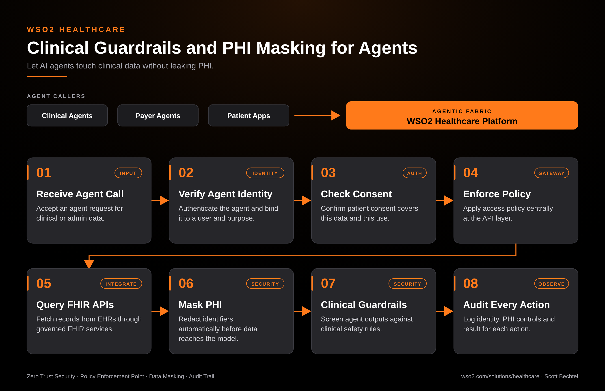

# Healthcare: Clinical Guardrails and PHI Masking for Agents

**Date:** 2026-10-30  **Product:** [Healthcare](https://wso2.com/solutions/healthcare/)

## Business Problem

A health system wants AI agents helping with chart summaries, referrals and payer questions. The agents need real patient records to be useful, and the moment a prompt carries a name, MRN or diagnosis to a model, compliance is in the room. Teams end up choosing between agents that can't see anything and agents nobody can audit.

## How WSO2 Solves This

WSO2's healthcare platform puts the controls between the agent and the record. Each agent gets its own identity, consent is checked before data moves, and policy is enforced centrally on the FHIR APIs. PHI is masked before it reaches the model, outputs are screened by clinical guardrails, and every action is logged with identity, PHI controls and result. The agent stays useful, and you can show an auditor exactly what it touched.

## Patterns Used

- Zero Trust Security
- Policy Enforcement Point
- Data Masking
- Audit Trail

## Architecture

---
WSO2 Healthcare · wso2.com/solutions/healthcare ·  by, Scott Bechtel
