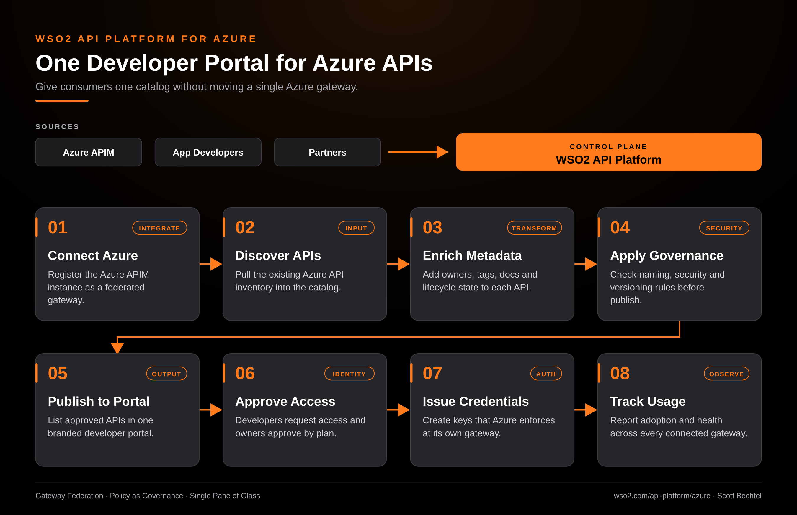

# API Platform for Azure: One Developer Portal for Azure APIs

**Date:** 2026-10-31  **Product:** [API Platform for Azure](https://wso2.com/api-platform/azure/)

## Business Problem

A team runs a few hundred APIs on Azure API Management, and the people who need them can't find them. Documentation sits in wikis, access requests go through email, and nobody can say which APIs follow the security and versioning rules. Moving the gateways just to get a decent catalog is a project nobody wants to fund.

## How WSO2 Solves This

WSO2 API Platform treats the Azure gateway as a federated gateway. It discovers the APIs already running there, lets owners add metadata and docs, and checks them against governance rules before anything is published. Approved APIs show up in one developer portal where consumers subscribe and get credentials. Traffic keeps flowing through Azure, so nothing gets migrated, and usage reporting covers every connected gateway in one place.

## Patterns Used

- Gateway Federation
- Policy as Governance
- Single Pane of Glass

## Architecture

---
WSO2 API Platform for Azure · wso2.com/api-platform/azure ·  by, Scott Bechtel
