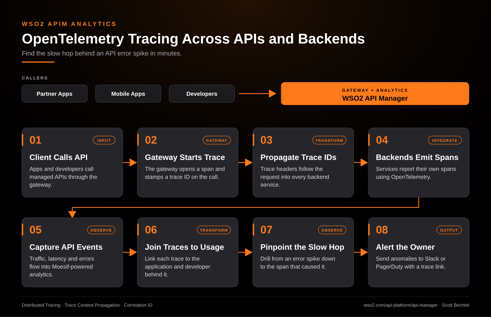

# APIM Analytics: OpenTelemetry Tracing Across APIs and Backends

**Date:** 2026-11-01  **Product:** [APIM Analytics](https://wso2.com/api-platform/api-manager/)

## Business Problem

An error spike shows up on the API dashboard, and the gateway looks fine. The slow part is three services deep, and nobody can tell which one. Teams end up grepping logs on four systems while partners watch their calls time out.

## How WSO2 Solves This

WSO2 API Manager opens a trace at the gateway and passes the trace context to every backend it calls. Services report their own spans with OpenTelemetry, and the traffic, latency and error data lands in the Moesif-powered analytics. Each trace stays tied to the application and developer behind it, so you can go from a spike to the exact span that caused it. Anomaly alerts go to Slack or PagerDuty, so the owner gets a trace to open instead of a guess.

## Patterns Used

- Distributed Tracing
- Trace Context Propagation
- Correlation ID

## Architecture

---
WSO2 APIM Analytics · wso2.com/api-platform/api-manager ·  by, Scott Bechtel
