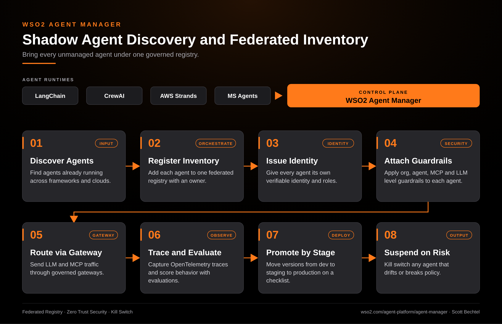

# Agent Manager: Shadow Agent Discovery and Federated Inventory

**Date:** 2026-11-02  **Product:** [Agent Manager](https://wso2.com/agent-platform/agent-manager/)

## Business Problem

Teams stand up agents in LangChain, CrewAI, AWS Strands and Microsoft's framework without telling anyone. Security can't say how many agents exist, who owns them, or what credentials they hold. You can't govern what you can't see, and the first time you find out about one is usually an incident.

## How WSO2 Solves This

Agent Manager works as one control plane over every runtime. It pulls agents running on the platform or somewhere else into a single inventory, so the shadow ones get an owner. Each agent gets its own identity, guardrails at the org, agent, MCP and LLM levels, and OpenTelemetry tracing. Versions move from dev to staging to production against the same checklist, and any agent that goes sideways can be suspended with one click.

## Patterns Used

- Federated Registry
- Zero Trust Security
- Kill Switch

## Architecture

WSO2 Agent Manager · wso2.com/agent-platform/agent-manager ·  by, Scott Bechtel
