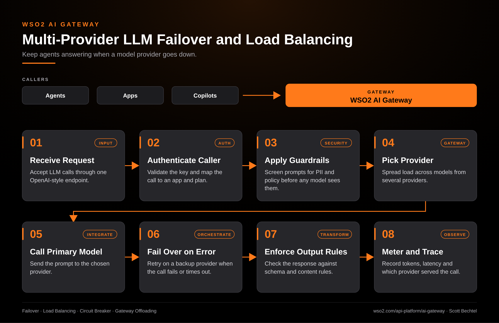

# AI Gateway: Multi-Provider LLM Failover and Load Balancing Flow

**Date:** 2026-11-03  **Product:** [AI Gateway](https://wso2.com/api-platform/ai-gateway/)

## Business Problem

One provider has a bad afternoon and every agent that depends on it stalls. Teams that hard-wire a single LLM endpoint into their apps find out about rate limits and outages from their users, then scramble to redeploy against another vendor.

## How WSO2 Solves This

WSO2 AI Gateway puts one endpoint in front of your model providers. It authenticates the caller, runs guardrails, then spreads traffic across the models you configure. When a call fails, the gateway retries on a backup provider so the agent never sees the outage. Every response gets checked against your output rules, and token counts, latency, and the serving provider land in one place. Your apps keep one URL and one key while you change providers behind it.

## Patterns Used

- Failover
- Load Balancing
- Circuit Breaker
- Gateway Offloading

## Architecture

WSO2 AI Gateway · wso2.com/api-platform/ai-gateway ·  by, Scott Bechtel
