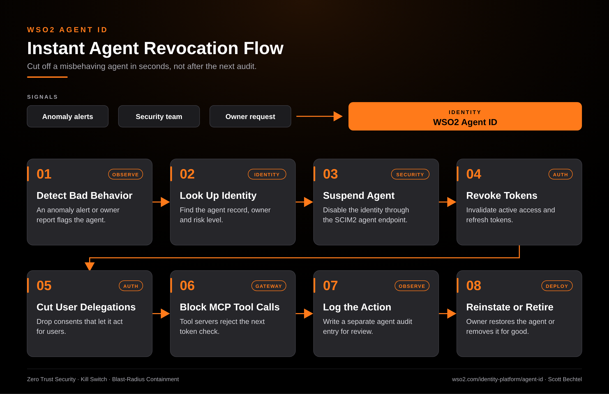

# Agent ID: Instant Agent Revocation Flow

**Date:** 2026-11-04  **Product:** [Agent ID](https://wso2.com/identity-platform/agent-id/)

## Business Problem
An autonomous agent starts calling tools it shouldn't, or acting for users who never expected it to. Revoking one API key doesn't help when the agent holds live tokens, user delegations, and access to several MCP servers. Every minute of delay widens the damage.

## How WSO2 Solves This
WSO2 Agent ID treats each agent as a first-class identity with an owner, a risk level, and its own audit trail. When an alert fires, you suspend the identity through SCIM2, revoke its tokens, and drop the user delegations tied to it. MCP servers behind the proxy reject the next token check, so the cutoff lands across every tool at once. The action is logged apart from human activity, and the owner can reinstate or retire the agent after review.

## Patterns Used
- Zero Trust Security
- Kill Switch
- Blast-Radius Containment

## Architecture

WSO2 Agent ID · wso2.com/identity-platform/agent-id ·  by, Scott Bechtel
