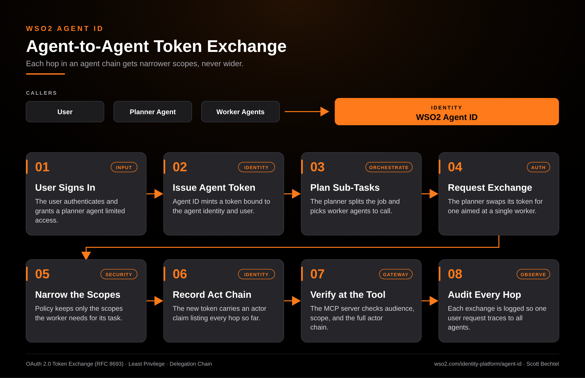

# Agent ID: Agent-to-Agent Token Exchange

**Date:** 2026-11-11  **Product:** [Agent ID](https://wso2.com/identity-platform/agent-id/)

## Business Problem

A user asks one agent to do a job, and that agent hands pieces of it to other agents. If every hop reuses the original token, the last agent in the chain holds far more access than its task needs, and nobody can tell who really authorized what. One compromised worker can then touch everything the user could.

## How WSO2 Solves This

WSO2 Agent ID treats each agent as its own identity and uses OAuth 2.0 token exchange (RFC 8693) at every hop. The planner swaps its token for one aimed at a single worker, and policy trims the scopes down to what that worker needs. The new token carries an actor claim listing every agent in the chain, so the tool or MCP server on the far end can check audience, scope, and the whole delegation path before it acts. Every exchange is logged, so one user request traces cleanly to every agent that touched it.

## Patterns Used

- OAuth 2.0 Token Exchange (RFC 8693)
- Least Privilege
- Delegation Chain

## Architecture

---
WSO2 Agent ID · wso2.com/identity-platform/agent-id ·  by, Scott Bechtel
