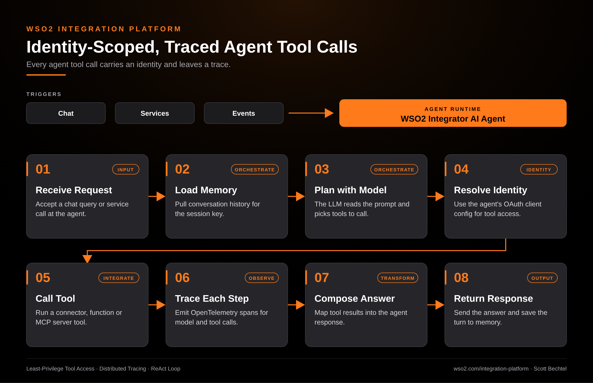

# WSO2 Integration Platform: Identity-Scoped, Traced Agent Tool Calls

**Date:** 2026-11-12  **Product:** [WSO2 Integration Platform](https://wso2.com/integration-platform/)

## Business Problem

An integration agent that can call Salesforce, a database and an MCP server is only as safe as the credentials behind those calls. When tools share one service account, nobody can say which agent touched what. When a call goes wrong, there is no trace to follow back to the prompt that caused it.

## How WSO2 Solves This

In WSO2 Integrator, an agent is a model, a system prompt, tools and memory on one canvas. Each tool is a connector operation, a function or an MCP server, and the agent's identity config supplies the OAuth client those tools use. Turn tracing on and every model call and tool call becomes an OpenTelemetry span. You get least-privilege access and an audit trail from the same flow, and you can run the agent from the in-IDE chat before it ships.

## Patterns Used

- Least-Privilege Tool Access
- Distributed Tracing
- ReAct Loop

## Architecture

WSO2 Integration Platform · wso2.com/integration-platform ·  by, Scott Bechtel
